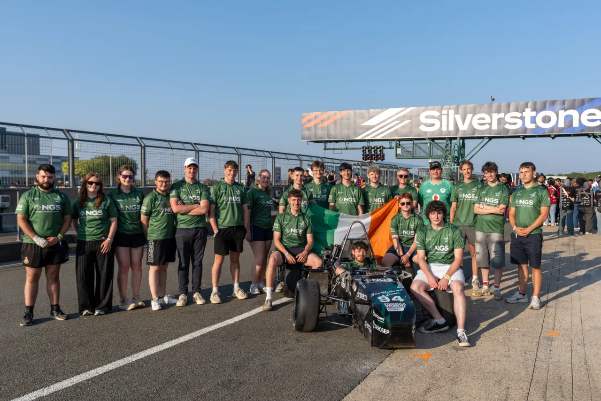
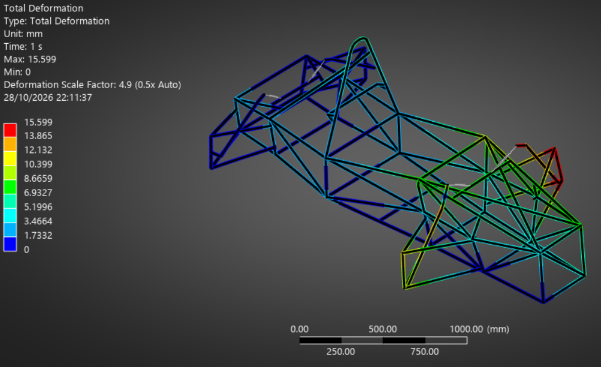
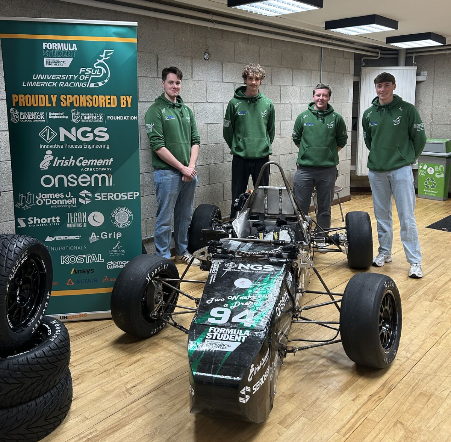
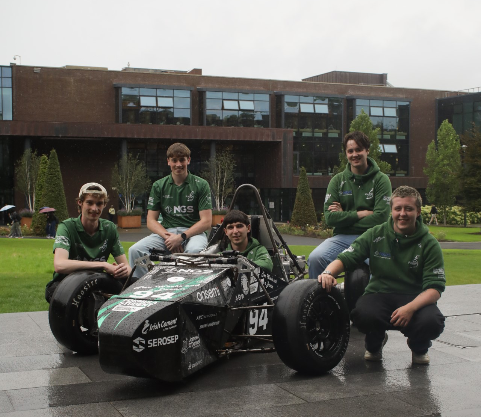

**Hi everyone,**

**The Formula Student UL team is 7 weeks into design, below are some updates from each of the sub-teams.**

## Suspension

The suspension team have familiarised themselves with entire suspension system, the definitions of the different parameters and each person has studied their individual part.

The team are researching and validating last year’s design. They are working closely with the Vehicle Dynamics team to create the initialparameters for the suspension package. Once this is complete, they will move on to designing the suspension for this year.

They have also completed compression testing of the air struts to get a force displacement curve. To do this the team organised a session in the Lonsdale Building, to test the air struts. The team didn’t have the exact figures for how much force it would take to compress the strut, by a given displacement. So, they measured it. They mounted a strut in a tensile tester and ran it in compression. They recorded the force the strut exerted at each displacement. The team will use this data to design the suspension, so that when the car is hit by these forces on track it responds the way they expect.

Multiple members of the suspension team are completing their Final Year Projects on suspension parts including the uprights, the control end, the brake system, and the gear box.

## Chassis

The chassis team are working on the firewall, seat, hard points, rockers, shock mounts, frame design, floor and pedal box mount.

Last year’s car has been dismantled, and members of the chassis team are examining, the parts that were used. They are validating last year’s design choices, using Finite Element Analysis (FEA), to decide if they can carry over elements into this year’s car. So far, they have completed a chassis frame torsional stiffness analysis to find out the tortional stiffness of last year’s frame. The suspension geometry was modelled for higher accuracy. This will be used for calculations performed by the Vehicle Dynamics team who will then advise the Chassis team, if the stiffness should be higher or lower this year for the best set up window. The torsional stiffness came in around 2000 Nm/degree which is a good benchmark.

The chassis team have also carried out FEA on last year’s shock mounts. Last year’s design was found to have a low factor of safety (FOS). The team will modify this year’s design to increase the FOS.

The team have created a mould for the seat, which will be scanned and uploaded into CAD. This will enable them to make a mould, which can be used to make a carbon fibre seat.

The team is using advice, that they received in scrutineering last year, to improve this year’s design. Namely using carbon fibre for the floor instead of steel, and using C or U channel steel to stiffen the pedal box mount.

The team is also working closely with the powertrain team to ensure that they have enough space for the engine and cooling systems.

## Powertrain

Since September, the Powertrain team have removed the engine and all powertrain parts out of the existing car. They have validated these parts and systems. They have worked on the general design for this year's engine, adjusting for this year's rules. They have begun testing some of the parts in the engine cooling system, mainly the cooling pump and the radiator. Members of the team are working on designing and building an engine testing rig, this will enable them to test the engine outside of the car. The team is on schedule to get the engine running by the end of November.

## Aerodynamics

The aerodynamics team are designing a front wing, rear wing, bodywork, side pods and floor for the car. Following advice from the Learn to Win seminar, the team have chosen not to run the front and rear wing during the competition but will make them for testing purposes.

The team have spent time analysing parts of the front and rear wings.

The Aerodynamics team created a portfolio of approximately 200 different air foils, each with different characteristics. They then imported them into VS Code and used XFOIL to run an analysis on their coefficient of lift and coefficient of drag characteristic. They used a weighting matrix to make decisions on what air foils are needed for different elements of the front and rear wing, based on their characteristics.

Following on from this the team have been working on 3D designs of the front wing and now have a first iteration for this year’s front wing.

The bodywork is largely a carryover from last year’s design, but the team have adjusted the CAD parts to fit around the redesigned chassis and suspension.

The team has a full bodywork block, that they are dividing up into individual panels, to allow them to begin making a manufacturing plan.

The team is carrying out design reviews every two weeks. The first review took place in late October, where they reviewed their initial concept design. A review of the CAD design and geometry will take place in early November and a review of the final designs of the first iteration of the aerodynamics package taking place at the end of the month.

## Electronics

The electronics team is working to build the functional, mandatory and desired electrical system of the Formula Student car. We are currently working on three main deliverables: Engine functionality, piloted sequential transmission development and regulation safety systems design-integration. The previous electrical development level and difference in rules mean that the team have essentially had to take the car from the ground up. In September, the Electronics team started from a very high level of understanding and abstraction to ensure everyone was familiar with what had to happen and are gradually developing each system. Currently, the team have schematics and lists to order for testing and will begin testing in November. They are broadly on track to meet our targets, but rule changes and procurement setbacks have seen some delay in our otherwise on-track schedule.

## Vehicle Dynamics

Vehicle dynamics is a new sub team of Formula Student UL. The aim of Vehicle Dynamics team is to help inform what car the Formula Student UL builds, using a top down approach.

The vehicle dynamics team has created a mathematical based model of the car, in MATLAB. This includes an empirical model of the tyres, that they fit to tyre data, purchased as part of the Formula Student tyre testing consortium.

They have also put together an optimization package that uses surrogate-based optimization to find the car that will give us the lowest skid pad time possible to try to maximize points in that event in the competition.

The team is currently working on setting the suspension geometry for the car. They are deciding where all the hard points on the car will go, to match the optimisation package.

They are also using the model of the car to find out how much brake torque is needed from the braking system to be able to lock up the tyres, to pass the brake test in Silverstone.

The team is planning to enter the MATLAB competition for the best use of MATLAB by a Formula Student team, this takes place in tandem with the Formula Student competition.

The team strives to maintain an industry level standard in their work. They use a private repository on GitHub for the version control of their code.

## Business Updates

The business and marketing team are working on improving the brand recognition of Formula Student UL. To achieve this, they have created a calendar for social media posts, to ensure regular activity across all platforms, including Instagram, LinkedIn and TikTok. The team is also working on a redesign of certain elements of the brand identity. The team is also in the process of designing a Formula Student UL website, which will be live in the coming months.

## Chief Technical Officer - Eoin Byrne

Following a hugely successful outing at Silverstone in July, our focus as a team has been firmly set on building upon that momentum and taking the next step forward ahead of FSUK27. From the moment we returned to the workshop, there was a shared determination across the team to push our capabilities further, challenge what we have previously achieved and set ourselves more ambitious targets for the year ahead.

We have established a clear vision of what we want to achieve at FSUK27, and I am pleased to say that progress across all disciplines is already demonstrating the commitment required to deliver it. As we approach our first design freeze, our concepts are beginning to take shape, with individual systems developing into increasingly detailed designs. Our emphasis on a continuous cycle of design, evaluation and redesign is already becoming central to the way we approach engineering decisions, ensuring that we are not simply designing to meet requirements, but constantly looking for opportunities to improve upon them.

Importantly, we have also moved beyond the design stage in several key areas, with testing already underway across a number of systems. Initial efforts have focused primarily on cooling and engine functionality, allowing us to begin validating our engineering decisions and identifying areas for further development at an early stage. This is a testament to the work being undertaken across the technical departments and the collaborative approach that is essential to progressing a project of this scale.

None of this would be possible without the continued support of our university and its facilities staff. Access to the facilities, resources and technical expertise available to us has been invaluable in allowing us to translate our designs into practical development and testing. Their contribution, alongside the dedication of every member of the team, continues to play a significant role in moving the project forward.

There is, of course, still a considerable amount of work ahead of us before FSUK27, and we are under no illusion that the challenges are behind us. However, the progress made so far gives us a strong foundation to build upon. What we are seeing now is only the beginning of what we hope to achieve this year, and I am confident that the direction we have set ourselves will continue to drive meaningful progress over the coming months. We look forward to sharing more of our development journey as we work towards delivering our ambitions at FSUK27.

## Open Days

Members of the Formula Student UL team were at the UL Open Days in October to highlight the team to prospective UL Students. Last year's car was also on display for the two days.

**The team also had the opportunity to set up a stand outside the Student Life Building during week 2 of the semester. This gave the team the opportunity to promote the brand and recruit new team members.**

**All the best,Formula Student UL**
